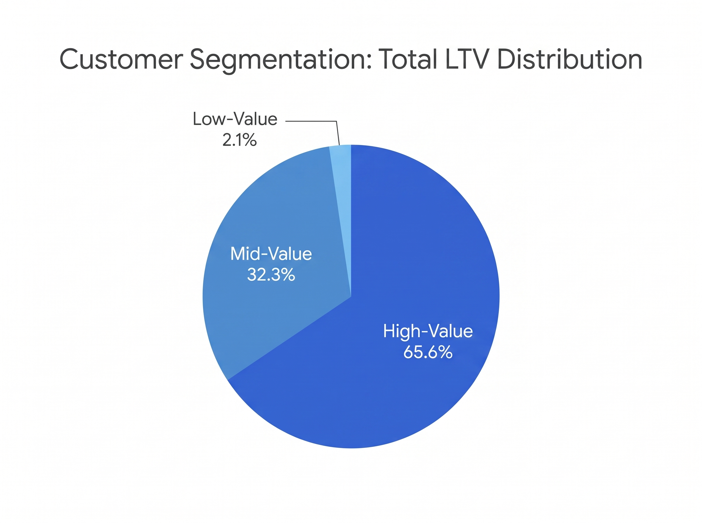

# Intermediate SQL - Sales Analysis

## Overview
{insert overview here}

## Business Questions
1. 
2. **Cohort Analysis:** How do different customer groups generate revenue?
3. 

## Analysis Approach

### 1. {insert analysis approach here}
- {insert analysis approach here}

🖥️ Query: [1_query_.sql](sql_1.sql)

**📈 Visualization:**

**📊Key Findings:**
- {insert key findings here}

**💡Business Insights**
- {insert business insights here}

### 2. Cohort Analysis
To identify our most valuable customers, we segmented the customer base according to their Total Lifetime Value (LTV). Using the 25th and 75th percentiles as financial thresholds, we grouped customers into three distinct tiers: Low-Value, Mid-Value, and High-Value. We then aggregated the total revenue generated by each segment to evaluate their overall financial impact on the business.

🖥️ Query: [2_cohort_analysis.sql](/2_cohort_analysis.sql)

**📈 Visualization:**

**📊Key Findings:**
- **Heavy reliance on the VIP sector:** The High-Value segment (the top 25% of customers) generates the vast majority of our total revenue, accounting for approximately 65.6% of all income.
- **Underperforming lower tier:** Despite representing a quarter of the entire customer base, the Low-Value customers contribute a negligible amount to the overall revenue (just 2.1%).

**💡Business Insights**
Our current revenue structure is highly top-heavy. While having a strong VIP base is highly profitable, relying on a small group of customers for nearly two-thirds of the revenue exposes the business to significant concentration risk. At the same time, the bottom 25% of the customer base represents a massive untapped potential. The primary focus must be on shifting customers up the value chain while aggressively guarding the VIP base against churn.

## Strategic Recommendations
*Low-Value Customers:*
1. **Targeted Discounts:** Offer personalized discounts or welcome-back promotions on their second purchase to encourage repeat buying behavior.
2. **Gamified Milestones:** Introduce lower-tier loyalty rewards that unlock immediately after crossing a small spending threshold to push them naturally into the Mid-Value tier.
3. **Re-engagement Campaigns:** Implement automated email and push notification workflows featuring best-selling, entry-level products to re-engage dormant buyers.

*Mid-Value Customers:*
1. **Bundle & Volume Offers:** Create product bundles or volume-based discounts to directly increase their Average Order Value (AOV).
2. **VIP Progression Incentives:** Launch an exclusive "VIP tier" loyalty program where reaching the High-Value spending threshold unlocks premium perks (e.g., free shipping, early access to sales).
3. **Cross-Selling:** Utilize personalized product recommendations based on their past purchase history to cross-sell higher-margin items.

*High-Value Customers (VIPs):*
1. **Premium Retention:** Offer exclusive rewards such as invite-only events, early access to limited-edition products, and surprise gifts to maximize retention and loyalty.
2. **Priority Support:** Assign dedicated account managers or provide a priority customer service channel to resolve their issues instantly and maintain the highest level of satisfaction.
3. **Proactive Churn Prevention:** Implement an automated alert system that triggers personalized outreach if a VIP's typical purchasing frequency begins to drop.

## Technical Details
- **Database:** {insert database here}
- **Analysis Tools:** {insert tools here}
- **Visualization:** {insert visualization tools here}